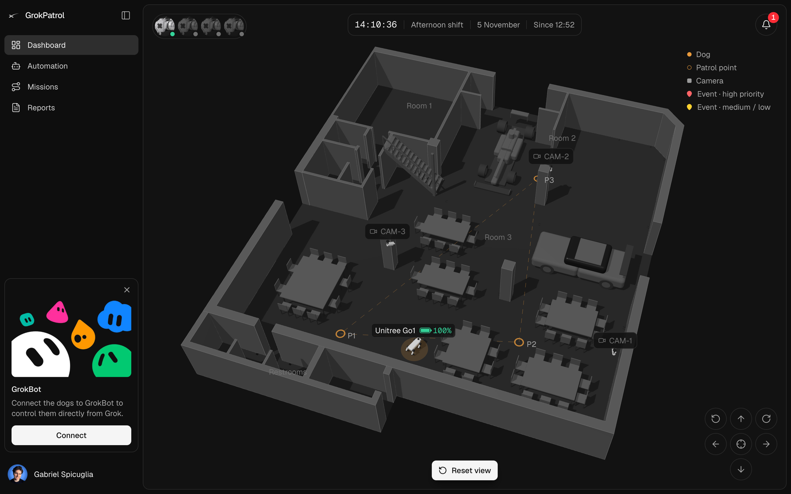
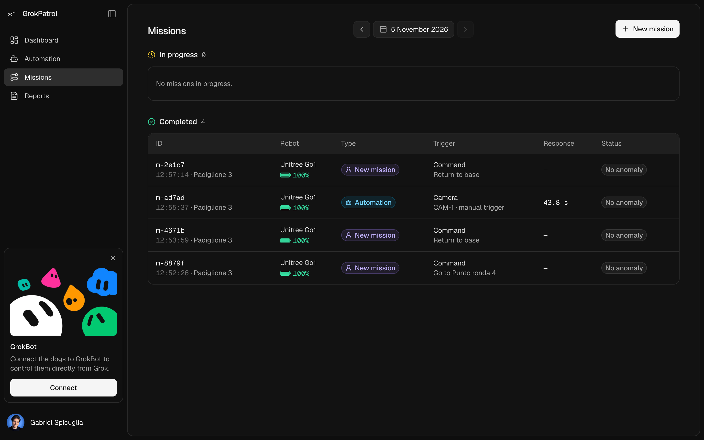
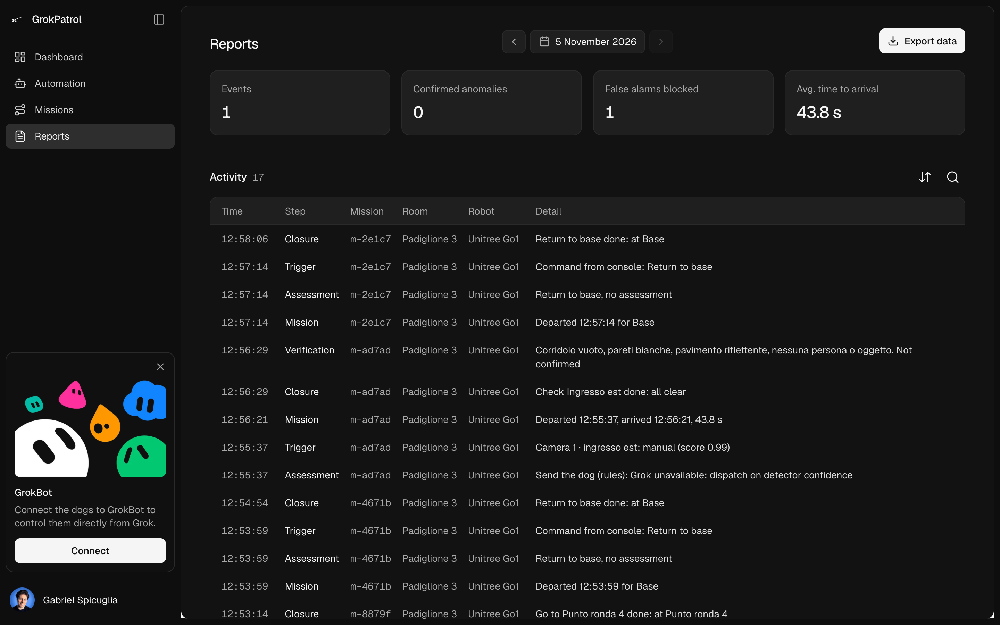
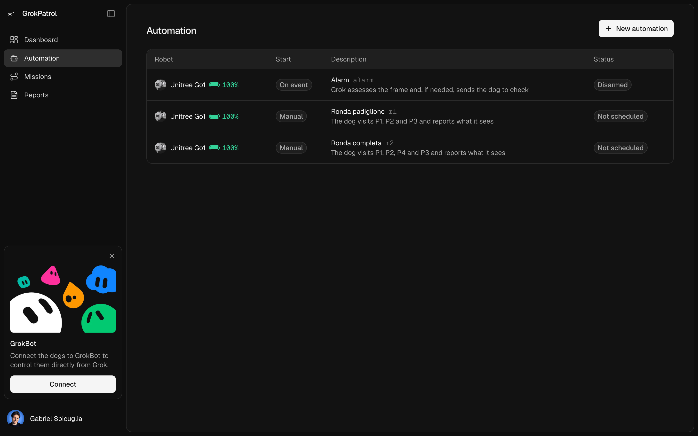
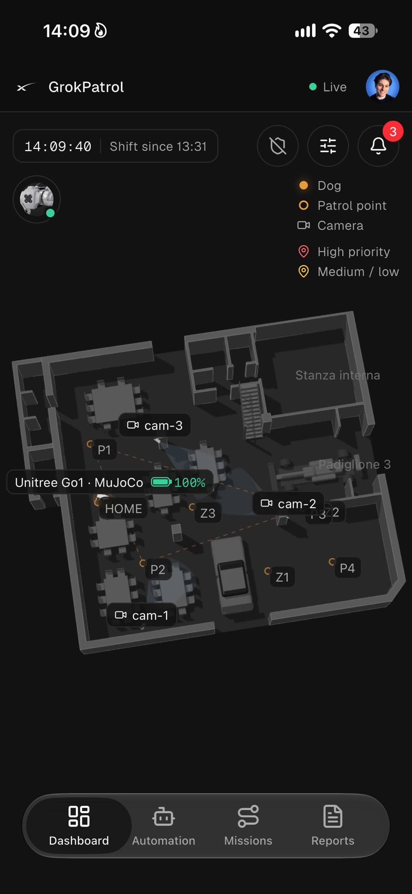
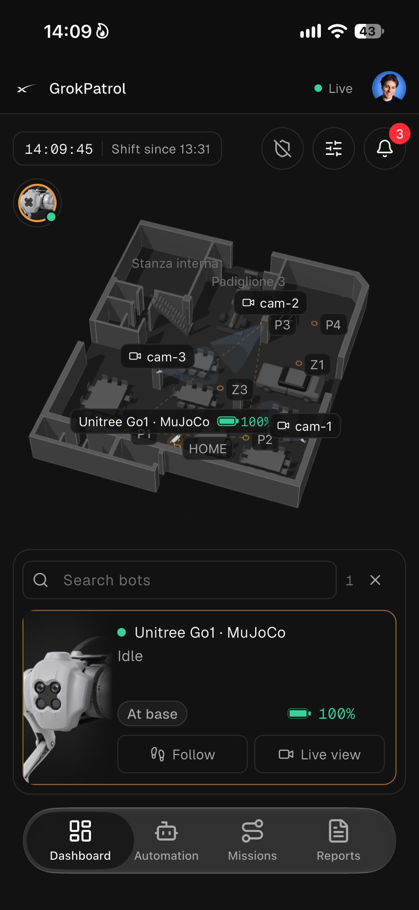
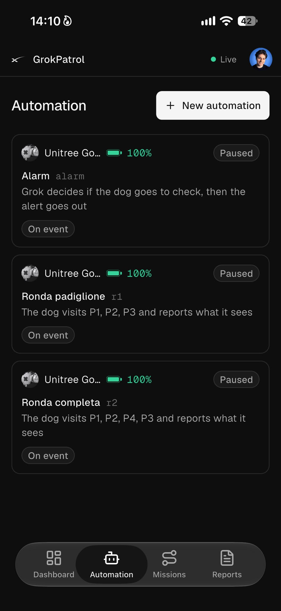
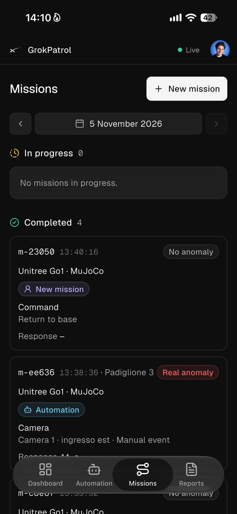
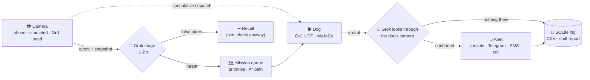

<div align="center">

# 🐕‍🦺 GrokPatrol · Ronda

**A robot dog that goes to check when a camera sees something strange.**

Camera event → Grok triage → the dog goes on site → Grok looks through its eyes → alert.
Same flow on a 3D physical museum (MuJoCo, the real Go1 model) and on the real **Unitree Go1**.


-111)


*Grok Hackathon · Track D (Riello)*



</div>

---

## Contents

- [Screenshots](#-screenshots)
- [How it works](#-how-it-works)
- [What's in the box](#-whats-in-the-box)
- [Quick start](#-quick-start)
- [Demo script (3 minutes)](#-demo-script-3-minutes)
- [Judging criteria](#-judging-criteria)
- [Grok](#-grok)
- [Alerts: Telegram, SMS, calls](#-alerts-telegram-sms-calls)
- [The alarm: armed and disarmed](#-the-alarm-armed-and-disarmed)
- [The simulator](#-the-simulator-everything-is-mujoco)
- [The real room (Pad3.step)](#-the-real-room-pad3step)
- [Calibrating the cameras](#-calibrating-the-cameras)
- [On site with the real Go1](#-on-site-with-the-real-go1)
- [Phones from any network](#-phones-from-any-network-public-tunnel)
- [Repository map](#-repository-map)

---

## 📸 Screenshots

### 🖥️ GrokPatrol console (`admin/web`)

| Dashboard: the live 3D map | Missions |
|---|---|
|  |  |
| **Reports**: events, confirmed anomalies, blocked false alarms, time to arrival and the full log | **Automation**: the alarm and the patrol routes |
|  |  |

### 📱 Mobile app (`grokdog_mobile`)

<table>
  <tr>
    <td align="center"><br><sub><b>Live 3D map</b></sub></td>
    <td align="center"><br><sub><b>The dog: follow · live view</b></sub></td>
    <td align="center"><br><sub><b>Automation</b></sub></td>
    <td align="center"><br><sub><b>Missions</b></sub></td>
  </tr>
</table>

---

## 🧠 How it works



1. **A camera fires.** A phone running the on-device detector, a simulated MuJoCo camera, or the Go1's own head camera.
2. **The dog starts moving at once** (speculative dispatch) while **Grok** assesses the snapshot and a zoomed crop.
3. **Grok says false alarm?** The dog is recalled. In the simulator it goes to check anyway (`ALWAYS_CHECK`).
4. **On arrival** the dog stops 1 m short, facing the spot, and Grok looks through its camera: confirmed or not.
5. **Grok writes the alert**: a console banner, a Telegram photo with a **📱 Apri nell'app** button, SMS and a voice call.
6. **Everything is logged** with event and mission ids, ready for CSV export and the end-of-shift report.

---

## 📦 What's in the box

| | Part | Where | What it does |
|---|---|---|---|
| 🧩 | **Backend** | `admin/backend` | FastAPI: missions, Grok, cameras, dogs, Telegram, alarm, automations, planner. **The one backend** for every client. |
| 🖥️ | **GrokPatrol console** | `admin/web` | Next.js admin with a 3D map, live dog and green path, missions, reports, automations and settings. |
| 📱 | **Mobile app** | `grokdog_mobile` | Flutter (iOS/Android), the same console in your pocket. Opens `grokpatrol://` links from Telegram. |
| 🛠️ | **Mac console** | `admin/backend/web` | The technical console: calibration, staged scenes, chat with Grok and the report. |
| 📷 | **Phone camera** | `/camera` | Any phone becomes a camera, with a detector running in the browser (tf.js + COCO-SSD). |
| 🌍 | **Simulator** | `sim/` | A physical MuJoCo museum with the Go1, cameras, people and a suitcase. |
| 🎨 | **Design** | `grokdog` | The original design of the console, with mock data. |

---

## 🚀 Quick start

```bash
./run.sh                       # backend → http://localhost:8000 · phones → https://<laptop-ip>:8443/camera
./sim.sh --no-cameras          # 2nd terminal: the MuJoCo museum (drop --no-cameras to also play Camera 1-3)
cd admin/web && npm run dev    # 3rd terminal: GrokPatrol console → http://localhost:3000
```

Keys go in **`secrets/.env`** (git-ignored):

```env
XAI_API_KEY=xai-...
TELEGRAM_BOT_TOKEN=...
TELEGRAM_CHAT_ID=...
```

| Variable | Default | Meaning |
|---|---|---|
| `DOG` | `mujoco` (via `./run.sh`) | `sim` kinematic dog without a simulator · `mujoco` physics · `go1` real dog over UDP · `go1mqtt` |
| `ALWAYS_CHECK` | on, off with `go1` | The dog checks on site even when Grok calls it a false alarm |
| `SITE_FILE` | `config/site.pad3.json` | `config/site.json` loads the generated test museum |
| `VMAX` / `WMAX` | `0.5` / `0.8` | Speed cap in m/s and rad/s |
| `PUBLIC_URL` | ngrok or LAN IP | The base address of the link in Telegram alerts |

`./run.sh` is a shortcut for `DOG=mujoco ./admin/run.sh`. The mobile app talks to the same backend
(see [`grokdog_mobile/README.md`](grokdog_mobile/README.md)).

Open http://localhost:8000. In **Stage a scene** pick a camera and press *Intruder*, *Abandoned bag*,
*Staff member* (should be filtered as a false alarm) or *Visitor* (walks outside the tape: no event).

---

## 🎬 Demo script (3 minutes)

1. **New shift** (log panel), then **Start patrol** on *Room 1 patrol*: the dog trots between p1, p2 and p3.
   Or say it: Mic → "patrol room 1".
2. **Intruder** on Camera 1. Watch the *Incident* panel:
   - detected at 0.0 s;
   - the dog moving at +0.0 s;
   - Grok answers "threat, severity 4" at about +1.5 s;
   - the dog is on the spot after about 10-15 s;
   - Grok describes what the dog frames;
   - the alert banner appears.
3. **Staff member** on Camera 2: Grok sees the high-visibility vest. The dog is recalled mid-way and no alert goes out.
4. **Abandoned bag** on Camera 3, then right after **Intruder** on Camera 2: two events at once. The intruder
   (severity 4) is handled first and the bag (severity 3) next. Both are verified and both alerted.
5. Console: "cosa è successo negli ultimi 10 minuti?", then **End-of-shift report** and **Export CSV**.

---

## 🏆 Judging criteria

| Criterion | What Ronda does |
|---|---|
| ⏱️ Time from event to arrival | The dog starts moving the moment the camera fires, while Grok assesses. It is recalled if Grok says false alarm. Shown per event and as an average. |
| ✅ Staged anomalies verified | Two looks: Grok triage on the camera snapshot (with a zoomed crop around the detection), then Grok on the dog's own camera on arrival. |
| 🚫 False alarms forwarded | Filtered twice: at triage (staff vest, statues, posters, our own dog, a person outside the tape) and on site (nothing found means no alert). |
| 📣 Clarity of the alert | Grok writes a title, an SMS (280 chars) and a spoken version for the call, from the data only. |
| 🧾 Completeness of the log | Every step is a row in SQLite with event and mission ids: detection, triage, dispatch, pause, arrival with seconds, verification, alert, recall and operator commands. CSV export. |

**Stretch goals done:**
- a console on the smartphone, both a responsive web console and the native app;
- several events at once, with a priority queue and missions shared per spot;
- false alarm recognition;
- the end-of-shift report.

---

## 🤖 Grok

| Use | Model | Typical time |
|---|---|---|
| Triage of the camera event | `grok-4.20-0309-non-reasoning` | ~1-2 s |
| What the dog sees on arrival | `grok-4.3` | ~3-8 s |
| Console (tool calling) and report | `grok-4.7` | ~3 s |

Change them in `secrets/.env` with `XAI_FAST_MODEL`, `XAI_VISION_MODEL` and `XAI_MODEL`.
`scripts/check_grok.py <image.jpg>` times every model on an image. If Grok is down, rules take over
(dispatch on detector confidence) and the log says so.

---

## 🚨 Alerts: Telegram, SMS, calls

The console banner always works. Add any of these to `secrets/.env`:

```env
TELEGRAM_BOT_TOKEN=...      TELEGRAM_CHAT_ID=...          # photo of the scene + text, free
TWILIO_ACCOUNT_SID=...      TWILIO_AUTH_TOKEN=...
TWILIO_FROM=+1...           ALERT_TO=+39...               # SMS + voice call (trial: verified numbers only)
```

- **Telegram** sends the photo, the text Grok wrote and a **📱 Apri nell'app** button. The button goes to
  `/open/mission/<id>`, which opens `grokpatrol://open/mission/<id>` in the mobile app, with a fallback link to
  the console. The base address is `PUBLIC_URL`, otherwise the ngrok tunnel, otherwise the Mac's LAN IP.
- The bot also accepts `/inserisci` and `/disinserisci` to arm and disarm the alarm.
- **Calls** are rate limited to one a minute and made only for severity 3 or more.

---

## 🔒 The alarm: armed and disarmed

**Arm alarm** in the console header (or `/inserisci` on Telegram, or "inserisci l'allarme" in the console)
starts an exit delay (`ARM_DELAY_S`, 15 s), then the alarm is armed. While disarmed, the cameras keep streaming
but raise nothing. While armed, the hall should be empty:

1. **A camera sees any movement**: part of the image changes against the background for half a second.
   There are no zones to draw. People found by the on-device detector travel with the event, to locate them.
2. **If only our dog moved** (its projected position is inside the moving area and no person is detected),
   the event is dropped without asking Grok. Patrols cost nothing.
3. **Grok decides whether the dog needs to check.** It looks at the frame and a zoomed crop:
   - **yes:** a person, a bag left behind, an open door, or anything it cannot explain;
   - **no:** light changes, shadows, reflections, our dog.

   A "no" gets a second opinion from the stronger model before it is final.
4. **The dog goes where it happened.** The feet or the object in the image are projected on the floor
   through the camera calibration. It stops 1 m short, facing the spot, then Grok looks and the alert goes out.

The state is saved in `data/alarm.json` and survives a restart. Every change is in the log, with who did it.
In the simulator, **Light change** dims the lights with nobody there: the false alarm Grok has to ignore.

---

## 🌍 The simulator: everything is MuJoCo

`./sim.sh` runs the whole museum as one physical MuJoCo scene:

- **🐕 The Go1** walks with MuJoCo physics and the trained joystick policy from MuJoCo Playground
  (`sim/assets/go1_playground`, Apache 2.0): 250 Hz physics, policy at 50 Hz. The server only sends velocity
  commands (vx, vy, wz) and reads back odometry, exactly as with the real dog. If it falls, it is set back on its feet.
- **🧱 Walls, tables, cars, stairs and display cases** are solid. The planner routes the dog around them (A* on the occupancy grid).
- **🧳 The suitcase** is a rigid body of about 6 kg: it falls, rests on its wheels and the dog can push it.
- **🚶 People** are mocap bodies walking along a path. The dog bumps into them, but cannot push them.
- **📷 Cameras** are MuJoCo cameras. The detector uses MuJoCo segmentation, the same output a phone detector gives.

`./sim.sh --viewer` also opens the native MuJoCo viewer (via `mjpython`, needed on macOS). Double-click a body
and Ctrl+drag to push it. `DOG=sim ./run.sh` falls back to a kinematic dog that needs no simulator.

---

## 🏛️ The real room (Pad3.step)

The default site is the real room, `config/site.pad3.json`, built from the CAD model `Pad3.step`
(17.5 × 20.5 m, walls 5.5 m). To import a new or updated model:

```bash
.venv/bin/python scripts/import_step.py path/to/room.step --out sim/assets/site
```

The import writes:
- the wall and ceiling meshes for MuJoCo;
- 96 invisible collision boxes, from the floor plan cut at 30 cm;
- the occupancy grid the dog plans on (around pillars, partitions and the `exhibits`);
- the floor plan the console draws.

Spots, cameras, zones and routes are in the site file, in metres. The `home` spot is where the real dog stands
when you press **Set home here**. The generated test museum is still there: `SITE_FILE=config/site.json ./run.sh`.

---

## 🎯 Calibrating the cameras

To send the dog where a person is, Ronda maps the image to the floor. In the Mac console, open **Cameras** →
**Calibrate**:

1. Tap a point on the floor in the image.
2. Tap the same point on the map. Corners of walls and pillars snap from the CAD. You can also use the dog's own
   position and tap its feet.
3. Repeat. Four pairs define the mapping. Six pairs spread over the view also give the error.

The projected plan is drawn on the image so you can check it. Expected accuracy is about 10 cm.
Calibrations are saved in `data/<site>.calib.json` and take priority over the pose in the site file.
Recalibrate whenever a phone moves.

---

## 🦿 On site with the real Go1

```bash
DOG=go1 ./run.sh                 # wifi: join the dog's hotspot (Unitree_Go...), dog at 192.168.12.1
DOG=go1 GO1_LINK=wired ./run.sh  # ethernet: laptop on 192.168.123.x, dog at 192.168.123.161
admin/backend/scripts/go1_check.py   # reads the Go1 without moving it
```

**Checklist**, with museum staff present:

1. **🌐 Network.** On the dog's wifi the laptop loses internet, and Grok needs it. Use either:
   - ethernet to the dog plus wifi to the internet, or
   - the dog's wifi plus iPhone USB tethering.

   Phones used as cameras must reach the laptop, but the detector models are served locally, so they work offline.
2. **🏠 Home.** Put the dog on its home spot, facing the room, and press **Set home here** (this resets odometry).
3. **📍 Teach the spots.** Drive with the arrows (W A S D, Q E to turn) and press **Save spot here** for each id
   (`p1`, `p2`, `z1`…). The spots are saved in `data/<site>.local.json`.
4. **📷 Phones.** On each phone, open `https://<laptop-ip>:8443/camera`, accept the certificate and pick the camera.
   You can also clip a phone on the dog as *Camera on the dog*, or start the Go1's head camera:
   **Cameras → Start dog camera** (`tools/nano/`).
5. **🛑 Safety.** Start with a short patrol. **Stop** cancels missions. **E-stop** blocks all motion until it is
   released. Without commands the dog stops by itself.

Odometry is the dog's own estimate (`HighState.position`) with the IMU heading. If the firmware does not report
position, the driver switches to integrating velocity ("dead reckoning"). That is fine for a room.

---

## 🌐 Phones from any network (public tunnel)

When the Mac is on the dog's wifi, the phones cannot reach it on a local network. `./public.sh` opens an
ngrok tunnel and prints a public `https://` address that works from the museum wifi or 4G, with a valid certificate.

- **PIN.** Access through the tunnel needs the PIN (`RONDA_PIN` in `secrets/.env`, 8 digits).
  - 10 wrong tries block an address for 10 minutes.
  - The browser remembers the PIN for 30 days.
  - On the Mac itself nothing is asked.
- **QR codes.** **Cameras → Phones** shows the address and QR codes that already carry the PIN.
- **Stopping.** Stop the tunnel with `pkill -f 'ngrok http'`. On the free plan, the address changes on every restart.

> Vercel cannot host Ronda: the server talks to the dog on its local wifi and keeps live connections and loops running.

---

## 🗂️ Repository map

```
admin/
├── backend/                  FastAPI, the one backend (console, mobile, phones, Telegram)
│   ├── app/main.py           API, websockets, /open links, Grok console tools
│   ├── app/mission.py        event pipeline, missions, priorities, patrols, timings
│   ├── app/grok.py           xAI: triage, verification, alert, patrol look, console, report
│   ├── app/telegram.py       alerts with photo + "Apri nell'app", /inserisci · /disinserisci
│   ├── app/automations.py    routes drawn in the apps and when to walk them
│   ├── app/planner.py        A* on the occupancy grid, around the furniture
│   ├── app/dogs/             sim.py · mujoco.py · go1.py (UDP) · go1mqtt.py
│   ├── app/vendor/ucl/       free-dog-sdk (MIT), Go1 protocol in pure Python
│   └── web/                  Mac console · camera.html (phone camera)
├── web/                      GrokPatrol console (Next.js 16, three.js 3D map)
└── run.sh
grokdog_mobile/               Flutter app (iOS/Android), deep links grokpatrol://
grokdog/                      the original design, with mock data
sim/                          MuJoCo museum: Go1 (Menagerie, BSD-3), cameras, people, suitcase
config/site.pad3.json         the real room: spots, cameras, exhibits, routes
tools/nano/                   MJPEG stream from the Go1's head (Jetson Nano)
scripts/                      check_grok.py · import_step.py
secrets/.env                  keys (git-ignored)
```

<div align="center">

Made with 🐾 at the Grok Hackathon

</div>
